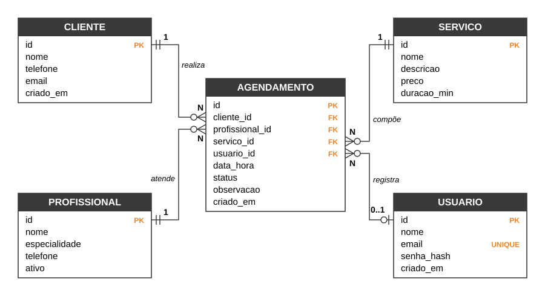

# AgendaFácil

Sistema web de agendamento para barbearias, desenvolvido para a disciplina **Projeto de Desenvolvimento de Software II** do curso de Engenharia de Software da **UniFil**.

**Autor:** Pedro Lamberto Barizon

O sistema permite cadastrar clientes, profissionais e serviços e montar a agenda de atendimentos. Ele impede que o mesmo profissional tenha dois atendimentos no mesmo horário, levando em conta a duração do serviço.

## Stack

| Camada | Tecnologia |
|---|---|
| Linguagem | Python 3.12 |
| Framework web | Flask 3.1 (com Jinja2) |
| Banco de dados | SQLite (relacional, via `sqlite3`) |
| Interface | HTML + Bootstrap 5.3 |
| Testes | `unittest` |

## Funcionalidades (CRUD)

| Entidade | Incluir | Consultar | Alterar | Excluir |
|---|:---:|:---:|:---:|:---:|
| Clientes (com busca) | ✔ | ✔ | ✔ | ✔ |
| Profissionais | ✔ | ✔ | ✔ | ✔ |
| Serviços | ✔ | ✔ | ✔ | ✔ |
| Agendamentos (filtro por data e status) | ✔ | ✔ | ✔ | ✔ |

Também tem login com senha guardada como hash, cadastro de usuário e uma página inicial com a agenda do dia.

## Como executar

Pré-requisito: Python 3.12 ou superior.

```bash
git clone <url-deste-repositorio>
cd agendafacil
python -m venv .venv
.venv\Scripts\activate          # Windows  (no Linux/Mac: source .venv/bin/activate)
pip install -r requirements.txt
python app.py
```

Abra <http://127.0.0.1:5000>. Na primeira execução o banco `instance/agendafacil.db` é criado com dados de exemplo.

Usuário de teste: `admin@agendafacil.com`, senha `admin123`. Também dá para criar outro usuário em "Cadastre-se".

Para recomeçar com o banco limpo, apague a pasta `instance/` e rode de novo.

## Testes

```bash
python -m unittest -v
```

## Estrutura

```
app.py              rotas, regras de negócio e CRUDs
db.py               conexão com o SQLite e dados de exemplo
schema.sql          criação das tabelas
templates/          páginas HTML (Jinja2)
static/estilo.css   ajustes visuais
tests/test_app.py   testes automatizados
docs/               documentação (PDF), diagramas e script que gera o PDF
```

## Documentação

- [Documentação completa (PDF)](docs/Documentacao_AgendaFacil.pdf): requisitos, casos de uso, DER, implementação e conclusão
- [Diagrama de casos de uso](docs/img/casos-de-uso.svg)
- [Diagrama entidade-relacionamento](docs/img/der.svg)


